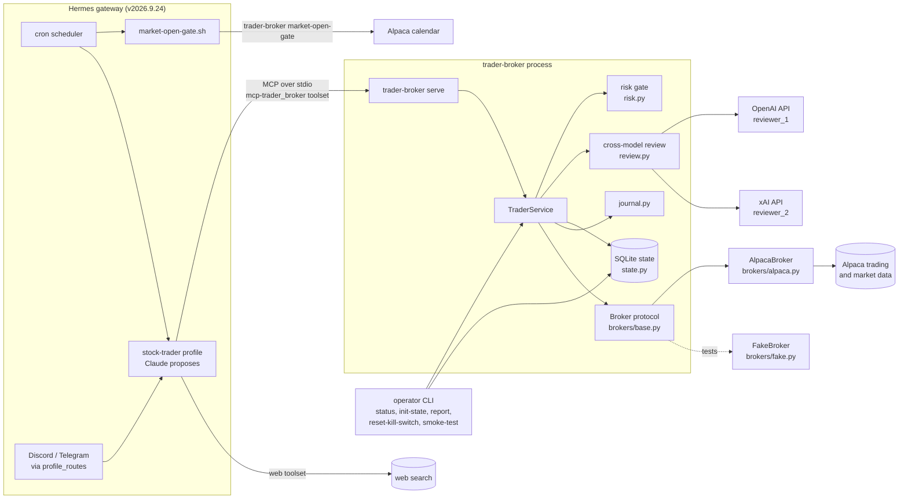
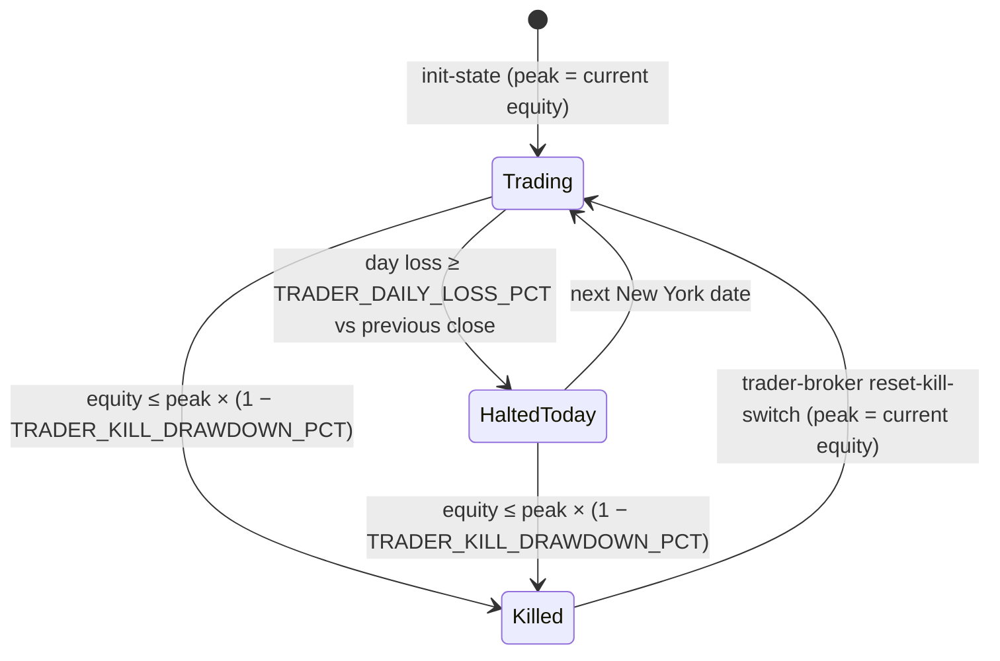

# Architecture

This repository lets a Hermes agent swing-trade US stocks without being able to break its own risk limits. It holds two things. The first is `trader-broker`, a Python MCP server and command-line tool. The second is the Hermes `stock-trader` profile (`profile/`) that uses it. Claude, running in the profile, decides what to buy and why. The server does everything that involves a number: it sizes each order, checks the caps and halts, has two models from other vendors review the buy, places a bracket order, and journals the result. The agent has no other path to the brokerage. The profile switches off Hermes' terminal, code-execution, file and browser toolsets, so the agent cannot edit the limits, read the API keys, or call Alpaca directly.

The server starts in paper mode. Live mode needs live keys plus an acknowledgement phrase set by hand (see [Failure modes and the live-mode guard](#failure-modes-and-the-live-mode-guard)).

## System context



Hermes launches `trader-broker serve` as a stdio MCP server when the profile connects. Everything below the MCP boundary is one Python process (`src/trader_broker/`). The operator uses the same code through other `trader-broker` subcommands, which are the only way to create the state database or clear the kill switch.

## Components

| Module | Role |
|---|---|
| `server.py` | `build_server`: the FastMCP server and its 16 tools. Each tool holds one in-process lock, so calls run one at a time. Every tool not annotated read-only (`get_risk_status`, `get_journal`, `propose_buy`, the exit tools and `journal_note`) also holds the account lock, so a second `serve` process or a CLI `status` on the same account waits its turn; a tool that cannot get it within `TRADER_ACCOUNT_LOCK_WAIT_S` (default 60 s) returns `{"status": "error", "reason": "busy"}`, and the agent retries later. The wait is kept short so that it plus the longest tool run (a buy's reviews, about 120 s) stays under Hermes's 300 s call timeout: the agent then always gets `busy`, never a timeout while its call is still queued and may yet place an order. Logs every call as JSON. Turns `BrokerError`, `StateUnavailableError` and unexpected exceptions into `{"status": "error", "reason": ...}` results instead of tracebacks. |
| `service.py` | `TraderService`: the logic behind every tool. It covers the equity refresh and halt latches, housekeeping, the buy path, the exit tools, journal access, and client-order-id idempotency. |
| `risk.py` | Pure functions with no I/O: `Caps`, `Portfolio`, `entry_price`, `size_position`, `check_entry`, `check_market_rules` and `check_halts`. Every check reports all the rules a buy breaks, not only the first. |
| `review.py` | `build_packet`, the `Reviewer` protocol, `OpenAICompatReviewer`, `HermesReviewer`, transport factory `build_reviewer`, `run_reviewers` (parallel threads), and `decide` (the decision rule). `hermes_inference.py` is the standalone, tool-free native inference helper. |
| `state.py` | `StateStore` over one SQLite file, plus `init_state`. Fails closed: opening never creates a file. |
| `account_lock.py` | `AccountLock`: an exclusive `flock` on `TRADER_BROKER_STATE_DIR/<mode>/trader-broker.lock` (`Settings.account_lock_path`), created on first use. It waits up to the given timeout, then raises `AccountBusyError`: `serve` passes `Settings.account_lock_wait_s` (`TRADER_ACCOUNT_LOCK_WAIT_S`, default 60 s), and CLI `status` keeps the 300 s default. The operating system releases it if the process dies. |
| `market.py` | Shared market conventions: `MARKET_TZ` (New York), `BENCHMARK_SYMBOL` (SPY, for settlement, the go-live report and the review's regime), `market_date`, `simple_return` and `close_on_or_before`. |
| `journal.py` | `record_entry` journals each placed buy. `settle_trades` closes entries and settles them against SPY. |
| `report.py` | `build_report`: the go-live scorecard. |
| `config.py` | `Settings.from_env`: every setting, read once from the environment at start. Also holds the live-mode guard and `require_reviewers`. |
| `cli.py` | The `trader-broker` command: `serve`, `status`, `init-state`, `reset-kill-switch`, `report`, `market-open-gate` and `smoke-test`. |
| `models.py`, `indicators.py` | Pydantic records (`Proposal`, `SizedOrder`, `Order`, `JournalEntry`, `Verdict`...), the `Price` type (above zero, at most `MAX_PRICE`), `round_price` (the tick rounding every price goes through, the Alpaca adapter's included), and the SMA, RSI, ATR, 52-week-high and average-dollar-volume indicators. |
| `brokers/base.py` | The `Broker` protocol, plus `BrokerError`, `RateLimitError` and `UnknownResultError`. |
| `brokers/alpaca.py` | `AlpacaBroker`, built on `alpaca-py`. |
| `brokers/fake.py` | `FakeBroker`: an in-memory broker for the unit tests that behaves like Alpaca where the server depends on it (bracket legs, reserved quantities, asynchronous cancels). |

**Module boundary rule:** only the `brokers/` package imports `alpaca`. The rest of the server talks to the `Broker` protocol and handles only the error types in `brokers/base.py`. `tests/unit/test_boundaries.py` enforces this by scanning every module outside `brokers/` for `alpaca` imports, and it also checks that `FakeBroker` satisfies `Broker`. Supporting another brokerage means writing one new adapter in `brokers/`.

### AlpacaBroker

`AlpacaBroker.from_settings` builds four SDK clients: trading (paper or live, following `TRADER_BROKER_MODE`), stock data, news and screener. Every SDK call goes through `_read` or `_write`.

- **Reads** retry an HTTP 429 three times, pausing 1 s, 2 s and 4 s first. Any other failure raises `BrokerError`.
- **Writes** never retry. A 429 raises `RateLimitError`, and other definite refusals raise `BrokerError`. If the outcome is unknown, the write raises `UnknownResultError` so the caller can look the order up by client order id instead of resubmitting. That happens on a timeout, a dropped connection, a 5xx, a reply with no status code, or a reply that does not parse.
- **Timeouts and SDK retries.** `alpaca-py` retries 429 and 504 responses itself, writes included, and by default waits forever for a reply. Version 0.44 has no public setting for either, so `_take_over_retries_and_timeouts` sets the clients' private attributes: `client._retry = 0`, and `client._session.request` gets a 20 s timeout. This depends on SDK internals. `pyproject.toml` therefore pins `alpaca-py==0.44.0`. Re-check these attributes before changing the pin.
- **Market data.** Two paths, with different feeds:
  - **The server's own daily bars** (`get_daily_bars`, used by the `min_adv` rule, the review packet's indicators, journal settlement and the smoke test) come from the consolidated SIP feed. The window ends at least 16 minutes ago, because the free plan serves SIP only for history, and the bars always end at the previous close.
  - **The agent's `get_bars` tool** and `get_quote` use the IEX feed, which the free plan serves in real time. `get_bars` bars of every timeframe, `1Day` included, run up to now, so the last daily bar is today's partial session. IEX volume is a small slice of consolidated volume, so it is useful only for comparing a stock's bars with each other; the server's SIP-based `min_adv` rule decides liquidity.
- **Order writes.** Orders are sent as JSON with string prices. A bracket is a GTC limit entry with a take-profit limit leg and a stop-loss leg. A sell is a market order, good for the day. A repair stop is a GTC stop. `replace_stop(order_id, stop_price, client_order_id)` PATCHes the order with the fresh `tb-` client order id the service minted and recorded.
- **Order listing.** Orders are read with `nested=true` and flattened, so each bracket leg appears as its own order with `parent_id` set. `get_orders("open")` merges two reads of at least 500 orders each: Alpaca's `status=open` listing, which reaches open orders of any age (an old GTC stop), and the newest orders of every status (`status=all`), which hold the working legs of a filled entry whether or not Alpaca's open listing includes them. Orders in both count once, and only open orders are kept, judging each leg by its own status.

## Tools

The agent sees 16 tools. Hermes exposes them as `mcp__trader_broker__<tool>`: `mcp__`, the server key, `__`, the tool name, with every character outside `[A-Za-z0-9_]` replaced by `_` (source: `tools/mcp_tool_schema.py`, `mcp_prefixed_tool_name`, and `website/docs/reference/mcp-config-reference.md` at v2026.9.24). No tool changes the caps, the mode, the kill switch or the credentials.

| Tool | Kind | What it does |
|---|---|---|
| `get_account` | read | Equity, previous close's equity, cash and buying power. |
| `get_positions` | read | Open positions. |
| `get_orders` | read | Open orders, newest first (read as described under [AlpacaBroker](#alpacabroker)). Bracket legs have `parent_id` set. |
| `get_quote` | read | Latest IEX bid and ask. |
| `get_bars` | read | Latest IEX bars: `1Min`, `5Min`, `15Min`, `1Hour` or `1Day`, with a limit of 1–1000. The last bar includes today's partial session. |
| `get_news` | read | Headlines for the given symbols, or for the market. |
| `get_movers` | read | The day's top gainers and losers, each with `change` (USD per share) and `change_pct`, its change since the previous close as a fraction (0.05 means up 5%). |
| `get_clock` | read | Whether the market is open, and the next open and close. |
| `get_risk_status` | destructive* | Runs housekeeping, then reports equity, day P&L, peak and drawdown, halts, exposure, the protection repairs it made (`protection_repairs`), open entries and recent blocks. |
| `get_journal` | write | Settles the journal (so it is annotated write, not read-only), then lists entries filtered by `open`, `closed` or `pending_lessons`. |
| `propose_buy` | write | The only way to open a position. See [The buy path](#the-buy-path). |
| `sell` | destructive | Market-sells `qty` shares. Any shares left keep a stop. |
| `close_position` | destructive | Sells every share held and cancels the symbol's open entries. |
| `tighten_stop` | write | Raises every open stop that protects the shares held. |
| `cancel_entry_order` | destructive | Cancels an unfilled entry that trader-broker placed, together with its legs. |
| `journal_note` | write | Records a lesson and clears the entry's pending flag. |

\* `get_risk_status` is annotated destructive because it runs housekeeping, which can cancel stale entries, cancel take-profit and limit sells that hold shares back from a stop, place stops, and market-sell a position whose bid is already at or below its stop. Every tool not marked read is annotated `readOnlyHint=false`; `destructive` tools also carry `destructiveHint=true`, `write` tools `destructiveHint=false`. `trader-broker status` prints the same report for a person, holding the account lock; when another process holds it too long, it prints a message and exits 1.

## What every tool call does first

Every tool starts with an **equity refresh** (`TraderService.refresh_equity`). It reads the account, then updates the stored halt latches in one `BEGIN IMMEDIATE` transaction. The steps are:

1. The stored peak rises to the current equity.
2. The kill switch latches once equity is at or below `peak × (1 − TRADER_KILL_DRAWDOWN_PCT)`.
3. The daily halt latches for today's New York date once `(equity − last_equity) / last_equity ≤ −TRADER_DAILY_LOSS_PCT`. Here `last_equity` is the broker's equity at the previous close.

Because the transaction holds the write lock, a `reset-kill-switch` from the CLI is never overwritten. Without a state database, the refresh skips the latches and halts read as unknown.

Write tools, `get_risk_status` and `journal_note` then run **housekeeping**. Other read tools do not; `get_journal` runs only its journal settlement step, so an entry never reads as open after its position is gone.

### Halts and the kill switch



- **Daily halt.** Once latched, it blocks buys for the rest of that New York date, even if equity recovers.
- **Kill switch.** It only latches. `update_halts` never clears it. Only `trader-broker reset-kill-switch` clears it, and that command also restarts the peak at the current equity.
- **What halts block.** Halts block only `propose_buy`. Sells, `close_position`, `tighten_stop` and `cancel_entry_order` are never blocked by a halt or by missing state.

### Housekeeping

`TraderService.housekeeping` runs these steps in order:

1. **Equity refresh**, as above.
2. **Resolve unknown buys.** Each entry whose submit outcome is unknown (see [Client-id idempotency](#client-id-idempotency)) is looked up by its client order id. A found order is adopted: its status is stored and it is journaled from the recorded proposal, sizing and review, unless a journal entry with its client order id already exists (`propose_buy` journals a placed buy even when storing its status failed). One still missing 5 minutes after its submit is closed as `rejected`. A failed lookup leaves it for the next pass.
3. **Cancel stale entries.** Any open trader-broker buy entry whose `created_at` is older than `TRADER_ENTRY_TTL_MINUTES` is cancelled. If the entry is partly filled, only its unfilled remainder is cancelled, and its legs start protecting the filled shares. There is no timer: entries expire only when some tool runs housekeeping. That is why the 15:45 `close-review` job calls `get_risk_status` before anything else that trades.
4. **Protect positions.** Orders are read again after the cancels, so coverage sees which legs they activated. For each position, housekeeping counts the shares that working stop sells cover:
   - A stop in `pending_cancel` covers nothing.
   - A bracket leg covers nothing while its entry is open and not completely filled, because Alpaca holds such legs inactive. Once the entry is filled or its remainder cancelled, the leg covers at most the entry's filled quantity, less what its legs, the take-profit included, have sold. A leg listed without its entry counts in full.

   Uncovered shares get a GTC stop through `submit_stop` (role `repair`), sized to the uncovered quantity; for a partly filled entry that is its filled shares. The broker reserves shares for every open sell, so housekeeping first cancels, and waits for, the symbol's sells that hold shares back without a stop guarding them: a take-profit leg whose stop leg is not working, or a plain limit sell. The legs of an entry that has bought nothing yet guard no shares and are left alone. The stop price is the stop of the newest open journal entry whose buy has filled, or 8% (`DEFAULT_STOP_PCT`) below the average entry price when the journal has none. If the bid is real and already at or below that stop, and the cancels were confirmed, the shares are market-sold instead. A bid of 0 or a missing quote is no price: the stop is placed, never a sale. Each repair is reported in `protection_repairs` (`ProtectionRepair`: symbol, qty, uncovered_qty, stop_price, action `stop_placed`, `sold` or `failed`, client_order_id, error).

   Before that, on every symbol where trader-broker has a working standalone stop, held or not: when stops cover more shares than are held (a repair stop placed while a bracket's legs were inactive, and the legs now work; or a leg that sold the whole position while a repair stop still works), trader-broker's own standalone stops are cancelled, newest first, until the excess is gone. A stop for more shares than the excess left is kept, since cancelling it would uncover held shares. Bracket legs are never cancelled for this.
5. **Reconcile.** Broker order statuses are copied into the state's `orders` table, and integrity violations are recorded, each once per `(kind, subject)`:
   - `foreign_order`: an open order trader-broker did not place. A bracket counts once.
   - `foreign_position`: a position larger than the open journal entries account for.
   - `entry_over_cap`: an entry whose stored sizing broke the symbol or risk cap.
   - `negative_cash`.
6. **Settle the journal.** See [Journal and settlement](#journal-and-settlement).

If the broker refuses one cancel or repair, or settlement fails, the error is logged and the pass continues.

## The buy path

`propose_buy(symbol, stop_price, target_price, thesis, invalidation, horizon_days, limit_price=None)` never takes a share count. `Proposal` validates the arguments: `horizon_days` must be 1–60, the thesis at most 2000 characters, and the invalidation at most 500.

```mermaid
sequenceDiagram
  participant A as Claude (stock-trader)
  participant S as TraderService
  participant B as Broker
  participant R as reviewers (OpenAI, xAI)
  participant D as SQLite state
  A->>S: propose_buy(symbol, stop, target, thesis, invalidation, horizon)
  S->>B: housekeeping (account, orders, positions, repairs)
  S->>D: update halt latches
  S->>B: account, positions, open orders, asset, quote, 260 daily bars, clock
  S->>S: halts + size_position + check_entry (check_market_rules if unsized)
  alt any rule fails
    S->>D: add_block (rule ids, reasons)
    S-->>A: blocked, every reason
  else gate passes
    S->>B: news, SPY daily bars
    S->>R: same review packet to both, in parallel
    R-->>S: verdicts (or errors)
    S->>S: decide: block, or apply the safer changes
    S->>D: add_review (packet hash, outcomes, decision)
    S->>B: clock, then check_entry on the final order
    S->>D: record_order_intent (new tb- client id, sizing)
    S->>B: submit_bracket_buy (once)
    S->>D: update_order, journal entry linked to the review
    S-->>A: placed, final order, reviews
  end
```



Every block is written to the `blocks` table, with the ids of the rules that refused it (`review` for a review block) and the reasons, and logged as a `buy_blocked` event. A block reason starts with its rule id (`daily_halt: ...`, `broker_error: ...`), except a review block, which starts with the reviewer's name.

### Risk gate

Settings are read once at server start. They are not tools, so the agent cannot change them. Percentages are fractions strictly between 0 and 1.

| Env var | Default | Rule |
|---|---|---|
| `TRADER_RISK_PCT` | `0.03` | `risk_size`: the loss at the stop, `qty × (entry − stop)`, is at most this share of equity. |
| `TRADER_SYMBOL_CAP_PCT` | `0.20` | `symbol_cap`: the symbol's held market value, plus the unfilled part of its open buys, plus this buy, is at most this share of equity. |
| `TRADER_DAILY_LOSS_PCT` | `0.04` | `daily_halt`: see the halts above. |
| `TRADER_KILL_DRAWDOWN_PCT` | `0.20` | `kill_switch`: see the halts above. |
| `TRADER_MIN_PRICE` | `5` | `min_price`: the lower of the entry limit and the ask is at least this many USD. |
| `TRADER_MIN_ADV_USD` | `20000000` | `min_adv`: the 20-day average dollar volume from SIP daily bars is at least this much. Fewer than 20 bars fails. |
| `TRADER_ENTRY_TTL_MINUTES` | `30` | Housekeeping cancels unfilled entries older than this. |
| `TRADER_ENTRY_SLIPPAGE_PCT` | `0.005` | Without `limit_price`, the entry limit is `ask × (1 + this)`, rounded to the tick. |
| `TRADER_NO_ENTRY_BEFORE_CLOSE_MINUTES` | `30` | `too_late`: no buy within this many minutes of the next close. |
| `TRADER_MIN_STOP_PCT` | `0.005` | `stop_invalid`: `(entry − stop) / entry` is at least this. |
| `TRADER_MAX_STOP_PCT` | `0.25` | `stop_invalid`: `(entry − stop) / entry` is at most this. |

Rules with no setting:

- `leverage`: positions plus open buys plus this buy must not exceed equity.
- `cash`: the buy's notional must fit in cash not already committed to open buys.
- `market_closed`: the clock must say the market is open.
- `not_tradable`: the asset must be active, tradable and `us_equity`.
- `target_invalid`: the target must be more than entry + $0.01.
- `stop_invalid`: the stop must be below entry and below the bid; a quote with no bid fails too.
- `qty_zero`: the sized quantity must be at least one share.
- `state_unavailable`: the state database must be open.
- `limit_invalid`: an agent-supplied `limit_price` must not be above `ask × (1 + TRADER_ENTRY_SLIPPAGE_PCT)`. A limit below the ask is allowed.
- `pending_unknown`: no buy of a symbol while an earlier buy of it has an unknown outcome (see [Client-id idempotency](#client-id-idempotency)).

Long-only is structural. No tool opens a short, and `sell` rejects a quantity above the shares held. Prices round half up to $0.01, or to $0.0001 below $1.

**Sizing** (`size_position`) takes the floor of the smallest of three limits:

- `risk_pct × equity / (entry − stop)`
- `(symbol_cap_pct × equity − symbol value) / entry`, where the symbol value is the held market value plus the unfilled part of the symbol's open buys
- `available cash / entry`

The binding limit is recorded as `bound_by`; it becomes `review` when a reviewer's size multiplier or raised stop cut the quantity. The order of checks is: halts first, then sizing, then `check_entry` on the sized order. When the buy cannot be sized (an invalid stop or target, or `qty_zero`), `check_market_rules` still checks the rules that do not depend on the share count (`limit_invalid`, `stop_invalid` against the bid, `min_price`, `min_adv`, `market_closed`, `too_late`, `not_tradable`). All failures are collected, so one block names every reason.

Prices the agent passes (`propose_buy`'s stop, target and limit, `tighten_stop`'s new stop) must be finite, above zero and at most `MAX_PRICE` ($1,000,000). Anything else, including NaN and infinities, returns an `invalid_request` error before the broker is read; it is not recorded as a block.

### Cross-model review

The server builds the `ReviewPacket` from broker data, so the proposer cannot frame the facts. The packet holds:

- the proposal and the sized order;
- the quote;
- indicators from about 260 SIP daily bars: SMA 20/50/200, RSI 14, ATR 14, distance from the 52-week high, and 20-day dollar volume;
- the last 60 closes;
- up to 10 headlines;
- the account's equity, cash, exposure and positions;
- the SPY (`BENCHMARK_SYMBOL`) regime: close against its 50- and 200-day averages.

Each reviewer gets the same canonical JSON packet. The packet's SHA-256 is stored with the review.

`OpenAICompatReviewer` calls an OpenAI-compatible chat-completions API in JSON mode, with `REVIEWER_TIMEOUT_S` per request (default 60) and SDK retries off. It retries once after an API error or an invalid verdict, and a second failure gives an error outcome. A reviewer that raises also gives an error outcome. The defaults are:

- `reviewer_1`: OpenAI at `https://api.openai.com/v1`, key in `OPENAI_API_KEY`.
- `reviewer_2`: xAI at `https://api.x.ai/v1`, key in `XAI_API_KEY`.

Model ids have no default. `REVIEWER_n_MODEL` must be set, or `serve` refuses to start. `REVIEWER_n_PROVIDER`, `REVIEWER_n_BASE_URL` and `REVIEWER_n_API_KEY_ENV` override the other defaults.

**Optional Hermes transport.** Each slot's `REVIEWER_n_TRANSPORT` defaults to `api`;
`hermes` selects `HermesReviewer` without changing the parallel review or decision
rule. Its provider must be explicitly `openai-codex` (Codex OAuth) or `xai` (API-key
authentication). The operator supplies absolute `TRADER_HERMES_PYTHON` (an executable
with native Hermes imports) and `TRADER_HERMES_HOME` (an existing auth-home directory,
normally the default `/home/hermes/.hermes`). Startup checks paths and model ids but
does not resolve auth or call inference. Hermes slots need no API key in the broker
environment; API slots retain their existing requirements. `BASE_URL` and
`API_KEY_ENV` do not override a Hermes route.

For each attempt the broker launches the packaged `hermes_inference.py` **as a file**
with the configured interpreter, an argument list (no shell), cwd set to the auth
home, and an allowlisted environment (`HOME`, `PATH`, `LANG`, plus explicit
`HERMES_HOME`). Stock-trader provider credentials, profile identity, Python import
overrides and proxy overrides are not inherited. The helper loads only the selected
home's `.env` before using native `agent.auxiliary_client.resolve_provider_client`
and its `.chat.completions.create()` facade. Hermes owns OAuth discovery/refresh and
Codex Responses adaptation; no OAuth tokens are copied to the profile. External
secret-manager commands are not bootstrapped. The native resolver receives the exact
provider/model, not `auto`; missing clients, changed resolved models or conflicting
effective-provider metadata fail closed. No agent, delegation, tool loop or fallback
chain is invoked. Only the fixed system prompt and canonical packet are sent.

JSON stdin carries the packet, SHA-256 and expected provider/model. JSON stdout
binds the verdict to those three fields; the broker verifies all bindings and the
`ReviewVerdict` schema. Extra envelope fields, duplicate keys, noisy or oversized
stdout and malformed verdicts are refused. Native diagnostics are suppressed in the
helper, and subprocess stderr/exception text is never included in outcomes or logs.
Every failure gets at most one retry. Each subprocess attempt (including startup) is
bounded by `REVIEWER_TIMEOUT_S`, with a monotonic total ceiling of twice that timeout;
the subprocess is killed and reaped on timeout. Failures become error outcomes and
block buys, never exits. The broker retains packet construction, validation, risk
gates, sizing, journaling and sole execution ownership. The proposer cannot submit
review approvals. Native auth/inference integration remains an operator-authorized
deployment check; tests stub Hermes and require no installed Hermes or credentials.

Each outcome carries a `verdict_name`: `approve`, `modify` or `reject` (`models.Verdict`), or `error`.

**Decision rule** (`review.decide`). The buy is blocked when any of these holds:

- any reviewer errored after its retry;
- any reviewer rejected with high confidence;
- no reviewer approved or modified.

Otherwise the safer changes from every verdict are applied:

1. The stop becomes the highest requested stop that is above the current stop and below entry.
2. The size multiplier becomes the smallest requested one (at most 1).
3. If the stop moved, the order is re-sized at the new stop.
4. The final quantity is `floor(min(original qty, re-sized qty) × multiplier)`, so it never grows. A requested `target_price` is advisory and ignored.

The decision is stored in `reviews` whether it proceeds or blocks. The final order then goes through `check_entry` again with a fresh clock, because reviews can take minutes.

### Client-id idempotency

Every order trader-broker places carries a client order id `tb-<uuid4>`. The id is recorded in the `orders` table, with the entry's sizing, before the order is submitted. `_submit_once` calls the broker exactly once. If the broker's reply is lost (`UnknownResultError`), the order is looked up by its client id. If the broker has it, it counts as placed. If not, `propose_buy` returns status `unknown` with the client order id: the order is never resubmitted, and the agent must not propose it again. The intent keeps its proposal, sizing and review id, housekeeping resolves it (see [Housekeeping](#housekeeping)), and new buys of that symbol are blocked with `pending_unknown` until then. An entry intent with no broker status is unresolved; a submit the broker refused is stored as `rejected`.

A buy must record its intent first, so missing state blocks it. Exits record their intent when state is available and submit anyway when it is not.

Reconciliation uses the `tb-` prefix to tell the server's orders from foreign ones. Bracket legs carry broker-generated ids, so a leg is recognised through its entry. A stop raised by `replace_stop` carries a fresh `tb-` id that the service mints and records with role `stop`.

## Exits

Exits are never blocked by halts or by missing state. Each exit tool runs housekeeping first.

- **`sell(symbol, qty)` / `close_position(symbol)`**
  1. Reject `invalid_qty` (below 1), `exceeds_position` (more than held, so never short) or `no_position`.
  2. Cancel every open non-market sell order on the symbol that reserves shares held: stops, and the legs of entries that have bought shares. The legs of an entry that has bought nothing (a pending add-on) are left alone, so that buy stays protected if it fills. `close_position` also cancels the symbol's open entries, so no buy can reopen the position; an unfilled entry's legs go with it. Then poll until the broker no longer lists them as open: up to 10 reads, 0.5 s apart, since Alpaca cancels asynchronously. If they are still open after that, or a poll fails, return `failed` / `cancel_unconfirmed` and sell nothing. Before returning, the orders are re-read, up to 20 times 0.5 s apart, until none of the symbol's sells is still `pending_cancel` (such an order reserves its shares, so the broker would refuse a stop for them); then the position is read and any shares no working stop covers get a GTC stop (never a sale, since the unconfirmed orders may still sell), reported in `protection_repairs`. If cancels are still pending and the broker refuses the stop, the repair is `failed`, and its error and the result's message tell the agent to call `get_risk_status` again in a minute, whose housekeeping places the stop once the cancels finish.
  3. Submit a day market sell.
  4. **Re-protect** any shares left with a GTC stop. The stop is the highest of the cancelled stops, which protected the shares held, or the housekeeping default when there was none. If the bid is real and already at or below it, sell those shares too.
  5. If the broker refuses the sell, re-protect every share held, because the cancelled legs no longer protect anything.

  Every repair an exit makes is listed in its result's `protection_repairs` (empty when none was needed).
- **`tighten_stop(symbol, new_stop)`** rounds `new_stop` to the tick and rejects it with:
  - `no_stop` when no open stop protects shares held (a pending entry's stop leg does not);
  - `unsupported_stop` when one of those stops is not a plain `stop` order (a `stop_limit` or `trailing_stop` placed outside trader-broker, which it cannot move);
  - `stop_not_raised` when it is not above the highest current stop (a stop is never lowered);
  - `stop_at_or_above_bid` when it is at or above the bid.

  Otherwise it replaces every open stop that protects shares held (each replacement recorded with role `stop`) and updates the stop recorded in the open journal entries of the bought shares. A pending entry's stop leg and journal stop keep their price.
- **`cancel_entry_order(order_id)`** cancels only an open, completely unfilled `tb-` buy entry, and its legs go with it. Legs, sells, foreign orders, closed orders and partly filled entries are rejected with `not_cancellable`.

## Journal and settlement

`record_entry` journals every placed buy. It stores the thesis, invalidation and horizon from the proposal, the final quantity and prices, and the id of the review that cleared it. During housekeeping and before `get_journal` reads, `settle_trades` advances each entry:

1. **Close.** An open entry whose symbol is no longer held is closed at the quantity-weighted average price of the symbol's sell fills since the entry opened. `closed_at` is the time of the last of those fills, and the trade return is stored.
   - An entry whose buy ended without any fill is closed with no exit price and is never settled.
   - A partly sold position is still held, so its entry stays open.
   - When the broker reports the entry order's fills, the entry's `entry_price` and `qty` become its average fill price and filled quantity, and returns use them.
2. **Settle.** A closed entry is settled once SPY's daily close for its exit date is available. Daily bars end at the previous close, and settlement only considers entries closed before today's New York date, so **a trade settles on the next trading day at the earliest**. Settlement stores:
   - `spy_return_pct`: SPY's close on the entry date to its close on the exit date;
   - `alpha_pct`: the trade's return minus SPY's;
   - `lesson_pending = 1`.
3. **Lesson.** `get_journal(status="pending_lessons")` lists settled entries without a lesson. `journal_note(entry_id, note)` stores the lesson and clears the flag. The `journal-review` skill also saves durable lessons to Hermes memory.

## Go-live report

`trader-broker report` (add `--json` for JSON) runs `build_report`. It measures from the state database's `paper_start_date`, which `init-state` sets to the New York date the database was created.

| Criterion | Pass when |
|---|---|
| `time` | At least 8 weeks (`GO_LIVE_WEEKS`) since `paper_start_date`. |
| `return` | The portfolio's return, from Alpaca portfolio history, beats SPY's close-to-close return over the same days. |
| `drawdown` | The maximum drawdown from a running equity peak is under 25% (`MAX_DRAWDOWN_PCT`). |
| `integrity` | Reconciliation recorded zero integrity violations. |

A criterion that cannot be measured yet fails. The report also counts blocked buys per stored rule id (`review` for a review block); a block with several rules counts once under each. For each reviewer it shows verdict counts and a hit rate on settled trades: an approve or modify of a trade that beat SPY counts as a hit, and so does a reject of one that did not.

Passing unlocks nothing. Switching to live is a manual change of keys and mode.

## State database

The database lives at `TRADER_BROKER_STATE_DIR/<mode>/state.db`. `TRADER_BROKER_STATE_DIR` defaults to `~/.local/share/trader-broker`, and `<mode>` keeps paper and live history apart. The schema is version 2 (`SCHEMA_VERSION`). Money is stored as decimal text and times as ISO 8601 text.

| Table | Holds |
|---|---|
| `account_state` | One row: schema version, equity peak, kill switch, daily halt date, `paper_start_date`. |
| `orders` | Every order intent by client order id: broker id, symbol, side, role (`OrderRole`: `entry`; `stop`, the replacement stop `tighten_stop` places; `sell`; `repair`), status, and for entries the sizing, proposal (JSON) and `review_id`; journal link. |
| `reviews` | Packet hash, every reviewer outcome, decision, final order. |
| `journal` | One row per placed buy, through close, settlement and lesson. |
| `blocks` | Every blocked buy with its rule ids (`rules`, a JSON list) and reasons. |
| `integrity_violations` | One row per `(kind, subject)`. |

`StateStore.open` opens the file read-write and never creates it. A missing file, an unreadable file, a non-SQLite file or a different schema version raises `StateUnavailableError`. Only `init_state` creates a database. It refuses to replace an existing one unless `--force` is given. A database written by an earlier schema (version 1) reads as unavailable; `trader-broker init-state --force` replaces it, discarding its journal, reviews, blocks and halts.

## The Hermes profile

`profile/` holds the `stock-trader` profile. `scripts/install-profile.sh` copies it to `~/.hermes/profiles/stock-trader/`. The Hermes keys and names below were checked against Hermes Agent v2026.9.24 (`github.com/NousResearch/hermes-agent`, tag `v2026.9.24`). Doc paths are relative to that repository.

### Model and persona

`profile/config.yaml` sets:

- `timezone: America/New_York`;
- `model.provider: anthropic`, with `model.default` filled in at install from `--model` or `ANTHROPIC_MODEL`;
- **no `fallback_providers`**. The reviewers run on OpenAI and xAI, and falling back to either would let the proposer and a reviewer share a vendor. If Anthropic is down, the run fails and the next scheduled run tries again.

`profile/SOUL.md` describes an aggressive, disciplined swing trader. It also states that sizing and caps are enforced by the tools, that every thesis must give the next earnings date, and that positions are not held through earnings unless the trade is about earnings.

### MCP server

```yaml
mcp_servers:
  trader_broker:
    command: uv
    args: [run, --directory, <INSTALL_DIR>, trader-broker, serve]
    env:                # every ALPACA_*, TRADER_BROKER_*, TRADER_*, REVIEWER_*,
      ALPACA_API_KEY: "${ALPACA_API_KEY}"   # OPENAI_API_KEY and XAI_API_KEY, each as "${VAR}"
      # ...
    trust: full
    timeout: 300
```

- **`env`.** Hermes passes a stdio server only a safe baseline environment plus this mapping. It resolves each `${VAR}` from the profile's `.env`. A variable that is unset or empty there arrives as the literal text `${VAR}`. `Settings.from_env` treats a value that is exactly an unresolved `${NAME}` as unset, and it treats empty values the same way. So the setting keeps its default, and a missing reviewer model or key stops `serve` at start. If you point `REVIEWER_n_API_KEY_ENV` at another variable, add that variable to the mapping.
- **`trust: full`.** Hermes calls these tools without asking for approval. This is required because cron runs are unattended and approval prompts fail closed there. It is safe because the limits are enforced inside the server.
- **`timeout: 300`.** Seconds per tool call. `propose_buy` can wait on two reviewers, each allowed 60 s plus one retry, and a write tool can first wait up to `TRADER_ACCOUNT_LOCK_WAIT_S` (60 s) for the account lock. The lock wait plus the longest tool run must stay under this timeout, so a queued call answers `busy` before Hermes gives up on it; raise them together.

Sources: `website/docs/reference/mcp-config-reference.md` and `website/docs/user-guide/features/mcp.md`.

### Toolsets

Identifiers are from <https://github.com/NousResearch/hermes-agent/blob/v2026.9.24/website/docs/reference/toolsets-reference.md>.

| Toolset id | Tools | In this profile |
|---|---|---|
| `trader_broker` → runtime `mcp-trader_broker` | the 16 `mcp__trader_broker__*` tools | **enabled**. Each MCP server gets a dynamic `mcp-<server>` toolset, and the bare server name is an alias ("Dynamic Toolsets → MCP server toolsets"). The skills' `requires_toolsets` names `mcp-trader_broker`. |
| `web` | `web_search`, `web_extract` | **enabled**: news and the next earnings date. |
| `memory` | `memory` | **enabled**: lessons between runs. `memory.memory_enabled: true`. |
| `skills` | `skills_list`, `skill_view`, `skill_manage` | **enabled**, with `skills.write_approval: true`. |
| `terminal` | `terminal`, `process_manage` | **disabled** |
| `code_execution` | `execute_code` | **disabled** |
| `file` | `read_file`, `write_file`, `patch`, `search_files` | **disabled** |
| `browser` | `browser_*` | **disabled** |

These are set in two places:

- `platform_toolsets` gives `cli`, `cron`, `discord` and `telegram` the same allowlist: `[trader_broker, web, memory, skills]`. Naming an MCP server in such a list also limits MCP tools to that server.
- `agent.disabled_toolsets: [terminal, code_execution, file, browser]` removes those toolsets on every platform after the allowlists are applied, so a platform list that still names one cannot bring it back. It does not hold against the operator: explicitly enabling one of these toolsets for a platform with `hermes tools` removes it from `disabled_toolsets`. Re-running the installer restores `config.yaml`, keeping the edited file as a backup. Sources: `website/docs/user-guide/configuration.md`, "Global Toolset Disable"; `hermes_cli/tools_config.py`.

Hermes has no toolset that holds only the skill-reading tools, and `skill_manage` cannot be disabled on its own. So skill writes are handled through `skills.write_approval: true` instead: every `skill_manage` change is staged for a person to approve (`/skills pending`) rather than applied.

The rest of the config is a backstop:

- `approvals.cron_mode: deny` and `approvals.unattended_mode: deny` refuse anything that would wait for a human.
- `plugins.enabled: []` loads no plugin.

### Skills

`profile/skills/trading/` holds five skills. Each has `metadata.hermes.category: trading` and `requires_toolsets: [mcp-trader_broker]`, and each names the `mcp__trader_broker__*` tools it calls.

| Skill | Job |
|---|---|
| `market-regime` | SPY/QQQ trend and breadth; today's posture. |
| `candidate-screen` | Setups from movers, news and the watchlist. |
| `trade-analysis` | Technical, fundamental and news case. Finds the next earnings date by web search and states it in the thesis. Calls `propose_buy` without a share count. |
| `position-review` | Re-checks open trades against their invalidation. Uses `tighten_stop`, `sell` and `close_position`. |
| `journal-review` | Works through `get_journal(status="pending_lessons")`, compares with SPY, records lessons with `journal_note` and in memory. |

### Cron schedule and the gate script

`profile/cron/jobs.yaml` declares five jobs. All times are US Eastern.

| Job | Schedule | Skills | Gate |
|---|---|---|---|
| `premarket-plan` | `0 9 * * 1-5` | market-regime, candidate-screen (no orders) | yes |
| `entries` | `45 9 * * 1-5` | market-regime, candidate-screen, trade-analysis | yes |
| `midday` | `30 12 * * 1-5` | position-review, candidate-screen, trade-analysis. Also closes positions with earnings before the next session, because on an early-close day the close review cannot. | yes |
| `close-review` | `45 15 * * 1-5` | position-review, journal-review. Starts with `get_clock`: on an early-close day the market has already closed, so it places no sells (a market order would wait for the next open) and lists the exits under "Exit at next open". Then `get_risk_status`, whose housekeeping cancels entries older than their time limit; then exits, settles lessons, posts the daily report. | yes |
| `weekly-report` | `30 16 * * 5` | journal-review: scorecard against SPY and the go-live criteria | no |

**Timezone.** Hermes v2026.9.24 cron has no per-job time zone. Every schedule is read in the profile's `timezone` (`America/New_York`), and a test keeps `jobs.yaml`'s `timezone` equal to it. Hermes works out how late a missed run may still start from each job's schedule. Sources: `website/docs/user-guide/features/cron.md`, `cron/jobs.py`.

**Gate script.** The four market-day jobs run `script: market-open-gate.sh`. Hermes resolves it only inside the profile's `scripts/` directory, which is where the installer copies `scripts/market-open-gate.sh`. Hermes reads the last line of the script's stdout, and `{"wakeAgent": false}` skips the run without calling the model. Hermes strips the profile's `.env` from a cron script's environment, so the script loads that `.env` itself. It then runs `uv run --directory <INSTALL_DIR> trader-broker market-open-gate`.

`market-open-gate` asks Alpaca's calendar whether today's New York date is a trading session. It does not check whether the market is open at that moment, so the 09:00 run before the open still happens. It always exits 0. On a configuration or broker error it prints `{"wakeAgent": true}`, and so does the script if the command cannot run at all: a broken gate never skips a run silently, and the server still enforces every rule.

**Delivery.** Each job's `deliver` lists `${TRADER_DISCORD_TARGET}` and `${TRADER_TELEGRAM_TARGET}`. The installer fills these in from the profile's `.env`, drops empty ones, and warns about jobs left with no target. Re-running it after the targets are filled in sets them on the existing jobs; it never clears a job's targets.

### `profile_routes` delivery

The profile has no bot tokens of its own. It posts through the default profile's existing Discord and Telegram bots. `profile/profile_routes.example.yaml` is a snippet for the **default** profile's `gateway:` section. It sets `multiplex_profiles: true` and two `profile_routes`, each mapping to profile `stock-trader`:

- one Discord channel, by `guild_id` and `chat_id`;
- one Telegram group, by `chat_id`.

These routes send messages from those chats to the profile and let its cron jobs deliver there; cron delivery needs a route with a `chat_id` and no `user_id`. Never route a DM chat id, because it would send all of that person's private chats with the bot to the trading agent.

A route selects a profile; it does not authorize anyone. Authorization stays with the receiving bot's profile (the default profile's allowlist), so anyone that bot accepts who can post in a routed chat can command the trader, including `sell` and `close_position`. The README therefore asks for a private channel and group and a narrow default-profile allowlist. A `user_id` route would match only one sender, but the location-only route that cron delivery needs still matches every sender in the same chat. Source: `website/docs/user-guide/multi-profile-gateways.md`.

### Installer

`scripts/install-profile.sh [--model ID] [--enable-jobs] [--dry-run]` can be re-run safely. It:

1. checks that `hermes` and `uv` are installed, that the model id uses only letters, digits and `._:/@+-` (it is written unquoted into `config.yaml`), and that the checkout path uses only letters, digits and `._/+-` (it is written into `config.yaml` and into the gate script's bash string);
2. runs `uv sync`;
3. creates the profile with `hermes profile create stock-trader --no-skills` if it is absent, so Hermes's bundled skills are not seeded;
4. copies `config.yaml` (filling in `<INSTALL_DIR>` and `<ANTHROPIC_MODEL>`), `SOUL.md`, the skills and the gate script, backing up any changed file with a timestamp suffix;
5. writes `.env` from `.env.example` (mode 600) while the profile's `.env` has no `NAME=value` line. `hermes profile create` seeds a comment-only `.env` (`hermes_cli/profiles.py`, `_finish_profile_layout`), which is backed up and replaced; a `.env` with settings is never touched;
6. reads the profile's existing jobs from `cron/jobs.json` (`hermes cron list` does not print prompts) and, by job name:
   - runs `hermes -p stock-trader cron create` for a missing job, with `--paused` unless `--enable-jobs` is given;
   - runs `hermes -p stock-trader cron edit <job id>` with only the settings that differ from `jobs.yaml` (schedule, prompt, skills, script, delivery targets). `cron edit` leaves the job paused or active as it was. Empty delivery targets are not compared, so a job's targets are never cleared.

`--dry-run` prints each change and command instead of running it and changes nothing under `~/.hermes`; uv may still create the checkout's `.venv` to read `jobs.yaml`.

It never writes `~/.hermes/config.yaml`. Instead it prints the routes snippet and the next steps: fill in `.env`, run `init-state` and `smoke-test`, merge the routes, then resume the jobs.

## Operator CLI

| Command | Does |
|---|---|
| `trader-broker serve` | Runs the MCP server on stdio. Needs Alpaca keys and both reviewers configured. Prints nothing to stdout, which carries the protocol. |
| `trader-broker status` | Runs housekeeping and prints the risk status as text. Holds the account lock; exits 1 with a message when another process holds it too long. |
| `trader-broker init-state [--force]` | Creates the state database, with the peak at the current equity. |
| `trader-broker reset-kill-switch` | Clears the kill switch and resets the peak to the current equity. |
| `trader-broker report [--json]` | Prints the go-live scorecard. |
| `trader-broker market-open-gate` | Prints `{"wakeAgent": true}` or `{"wakeAgent": false}` as its last line. |
| `trader-broker smoke-test [--symbol SPY]` | Paper mode only. Fetches a quote and SIP daily bars, places a 1-share bracket at half the last close (so it never fills), checks the legs and the client-id lookup, then cancels it. |

Every subcommand reads `Settings.from_env()`, live-mode guard included. A command exits 2 on a configuration error, and 1 on a broker error, a state error, or an existing database without `--force`.

`uv run pytest -m paper` runs the same smoke steps. **The paper smoke test has not yet been run against a live Alpaca paper account.**

## Failure modes and the live-mode guard

| Scenario | What happens | Recovery |
|---|---|---|
| State database missing, corrupt, or a different schema (including a schema-1 database) | `serve` still starts and logs a warning. Equity refresh skips the latches, and halts read as unknown. `propose_buy` blocks with `state_unavailable`. Sells, stops, cancels, reads and housekeeping repairs still work. `get_journal` and `journal_note` return `state_unavailable` errors. A missing file is never re-created silently, so a lost file cannot clear the kill switch. | `trader-broker init-state` (`--force` replaces a corrupt file), then restart the MCP server so it opens the new database. |
| Reviewer outage, timeout or bad JSON | Each reviewer gets one retry. A second failure is an error outcome, and the buy is blocked with `<reviewer>: review failed: ...`. Exits are unaffected. | The next run tries again. The report counts these under `review`. |
| Reviewer not configured | `serve` exits 2 at start, naming the missing `REVIEWER_n_MODEL` or key. | Fill in `.env`. |
| Broker error or timeout on a read | A request with no reply for 20 s times out, and a read that gets a 429 is retried three times. The tool returns `{"status": "error", "reason": "broker_error"}`. Before submit, `propose_buy` blocks with `broker_error`. | The next call. |
| Broker timeout on a write | `UnknownResultError`. The order is looked up by its `tb-` client id: if the broker has it, it counts as placed; if not, `propose_buy` returns `unknown`, the buy is never resubmitted, and housekeeping resolves it. A failed exit is reported as `failed`, and remaining shares are re-protected where possible. | Housekeeping reconciles statuses and re-protects uncovered shares on the next call. |
| Sell cancels not confirmed | `sell` or `close_position` returns `cancel_unconfirmed`, sells nothing, and gives any uncovered shares a GTC stop (`protection_repairs`). While cancels are still pending the broker can refuse that stop: the repair is `failed` and the message says to call `get_risk_status` again. | Call `get_risk_status` or the exit again in a minute; the next housekeeping pass re-protects anything still uncovered. |
| Account lock busy | Another trader-broker process on the same account held the lock for over `TRADER_ACCOUNT_LOCK_WAIT_S` (60 s; 300 s for CLI `status`). The tool returns `{"status": "error", "reason": "busy"}` and did nothing; CLI `status` exits 1. | Try again shortly. |
| Kill switch tripped | Every buy is blocked with `kill_switch`. Sells and stop raises still work. | `trader-broker reset-kill-switch`. |
| Daily halt | Buys are blocked with `daily_halt` for the rest of the New York date. | Clears itself the next day. |
| Market closed or holiday | The gate skips the gated jobs. `propose_buy` blocks with `market_closed`, or with `too_late` near the close. | The next session. |
| Gate cannot run | Prints `{"wakeAgent": true}`; the run goes ahead and the server's rules apply. | Fix the gate's configuration. |
| Anthropic unavailable | No fallback provider, so the run fails. | The next scheduled run. |
| Unexpected exception in a tool | Logged with its traceback. The tool returns `internal_error`, and the server keeps running. | Read the log. |

**Live-mode guard.** `TRADER_BROKER_MODE` defaults to `paper`. Setting it to `live` is accepted only when `TRADER_BROKER_LIVE_ACK` is exactly `I_ACCEPT_REAL_MONEY_RISK`. Otherwise `Settings` validation fails, and `serve` and every other subcommand exit 2 with "refusing to trade real money". `smoke-test` refuses any mode but paper. Paper and live keep separate state databases and logs under `TRADER_BROKER_STATE_DIR/<mode>/`.

## Observability

`configure_logging` writes one JSON object per line to stderr and to `TRADER_BROKER_STATE_DIR/<mode>/logs/trader-broker.log`. The file rotates at 10 MB and keeps 5 backups. Every configured Alpaca and reviewer secret is replaced with `[REDACTED]`. FastMCP's own logger is routed through the same handlers, and nothing is logged to stdout.

Each tool call is logged as a `tool_call` event with its arguments, outcome, reason and duration. The buy path also logs these events:

- `risk_decision` when the gate passes;
- `review_decision`, with each reviewer's verdict;
- `buy_blocked`, with every reason.

There are no metrics.
