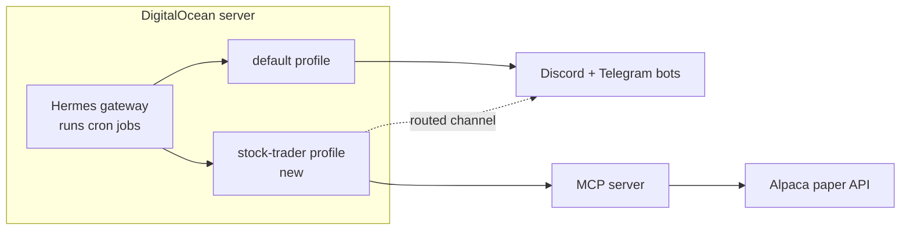
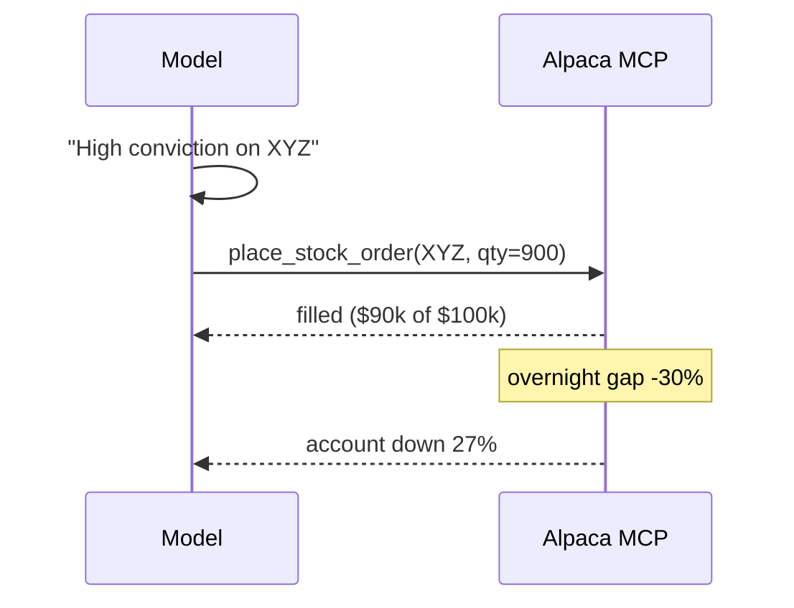
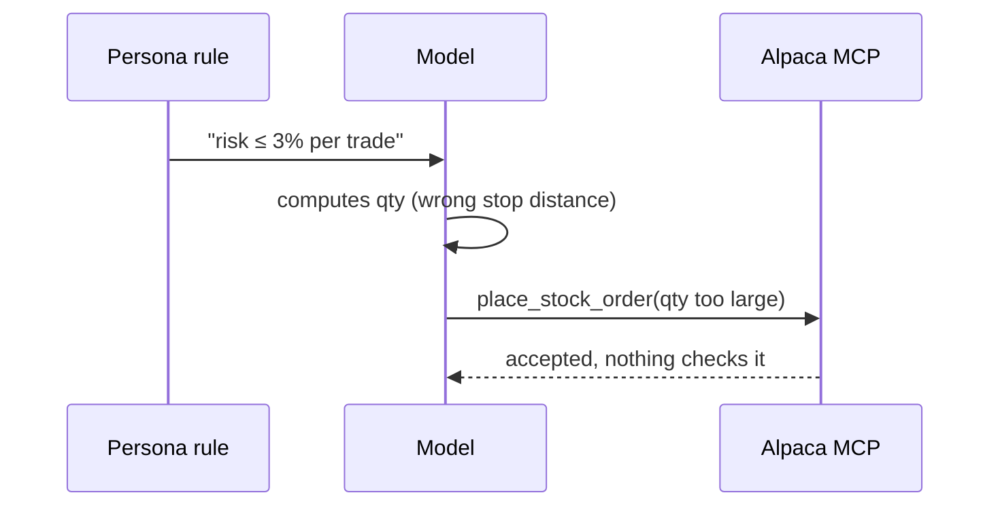
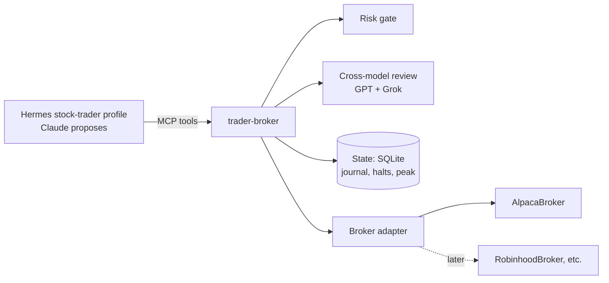
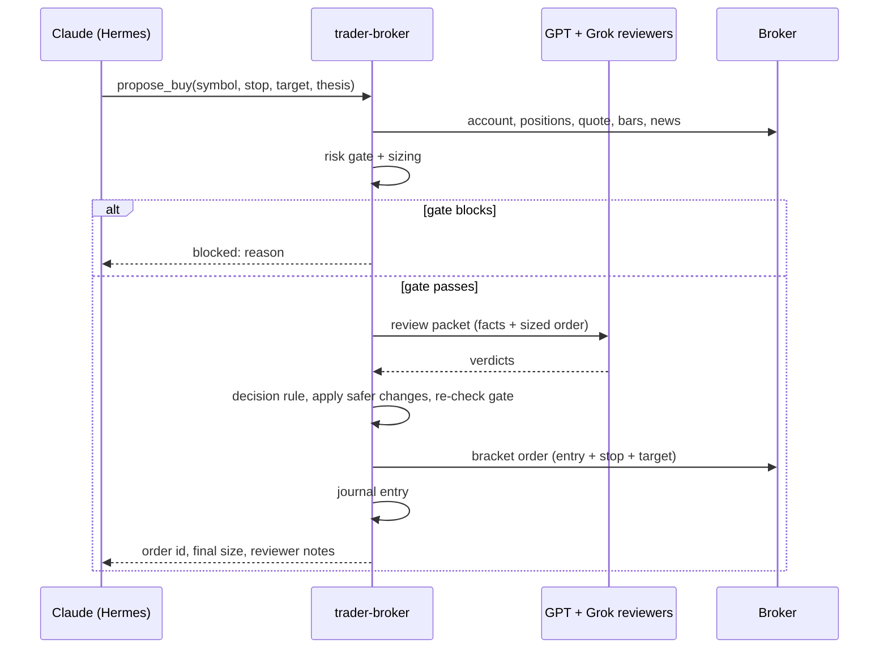
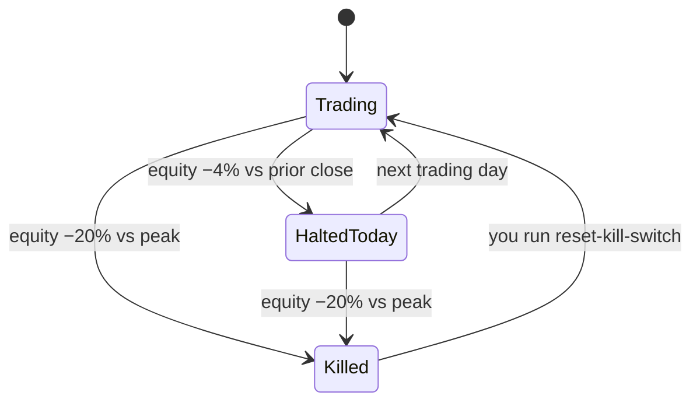
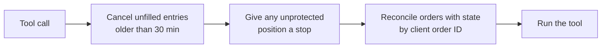
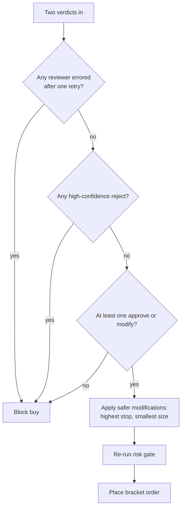
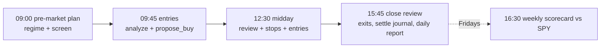

# Master Plan: Hermes Trader Profile

Created: 2026-11-03
Status: confirmed

---

## ABOVE THE LINE — Design Narrative

### Background

You already run Hermes Agent on a DigitalOcean server, connected to Discord and Telegram. Hermes calls each isolated agent setup a **profile**: a folder under `~/.hermes/profiles/<name>/` with its own model config, persona file (`SOUL.md`), skills, memory, API keys and scheduled jobs. Hermes reaches outside tools through **MCP servers**, small programs that expose named tools the model can call.

Alpaca is a commission-free US broker with a free paper-trading account ($100k simulated) and an official MCP server. Alpaca's article wires that server into Claude Desktop and lets the model place orders directly.



We are adding a `stock-trader` profile next to your default one. It swing-trades US stocks (holds for days to weeks) on Alpaca paper, aiming for the highest return it can reach inside hard limits you chose.

### The Problem

An LLM with direct broker access can lose real money in ways a prompt cannot stop. Two research findings make this concrete.

First, neither Hermes nor Alpaca's MCP server caps order size or daily losses. Alpaca's server exposes `place_stock_order` with whatever quantity the model picks, plus `close_all_positions` and `cancel_all_orders` with no confirmation hints ([alpaca-mcp-server #127](https://github.com/alpacahq/alpaca-mcp-server/issues/127), [#60](https://github.com/alpacahq/alpaca-mcp-server/issues/60)). Hermes approval prompts fail closed in unattended cron runs, so you cannot keep a human in the loop for scheduled trades either.

Second, aggressive LLM trading has a poor live record. Press coverage of Alpha Arena season 1.5 (US stocks, Nov 2025) reported most models losing money. FINSABER found LLM strategies turn too aggressive in falling markets. A public ChatGPT real-money experiment on micro-caps ended down 17% after a 50% drawdown.

**Failure case: the oversized bet.** The model reads a strong story, picks the share count itself, and puts most of the account into one name. An earnings gap does the rest.



**Failure case: the prompt-only limit.** A "never risk more than 3%" rule in the persona holds until the model miscounts or argues itself past it. StockBench measured LLM agents making arithmetic and schema errors on exactly this kind of sizing step.



### The Design

We recommend a small Python MCP server, `trader-broker`, as the agent's only path to the broker. The model reasons about what to buy and why. Code does everything with a number in it: sizing, caps, halts, and order construction. FinRobot's authors call this "models reason, software computes", and it was the strongest pattern in the prior art we surveyed.



#### Broker adapter

A `Broker` interface hides the brokerage behind a dozen methods: account, positions, orders, quotes, bars, news, clock, and bracket-order placement. `AlpacaBroker` implements it with Alpaca's Python SDK (`alpaca-py`), not Alpaca's MCP server, so we run one process instead of two. A `FakeBroker` implements it in memory for tests. Moving to Robinhood or another broker later means writing one new adapter.

#### The buy path

`propose_buy` is the only tool that opens a position. The agent supplies a symbol, a stop price, a target, a thesis and an invalidation condition. It never supplies a share count.



#### Risk gate

The risk gate runs in code before any buy reaches the broker. These are the limits you set:

| Rule | Limit |
|---|---|
| Direction | Long only |
| Leverage | None: open positions plus pending buys never exceed equity; new buys only from cash |
| Risk per trade | Loss at the stop ≤ 3% of equity |
| Per stock | ≤ 20% of equity, counting any existing position and pending buys |
| Price and liquidity | Price ≥ $5; 20-day average dollar volume ≥ $20M |
| Daily halt | Equity down 4% from yesterday's close blocks new buys for the rest of the day, even if it recovers |
| Kill switch | Equity 20% below its all-time peak blocks new buys until you reset it by hand |

Share count is the smallest of the 3% risk size, the 20% cap and available cash, rounded down to whole shares. Every buy goes out as a bracket order, so Alpaca holds a stop on its own servers from the moment the entry fills.

Sells never face a block. The agent can always close or reduce a position and raise a stop; the server cancels the bracket's resting orders first and re-protects any shares left. No new buys start in the last 30 minutes before the close. It cannot lower a stop or remove one.



#### Housekeeping

Every write tool call starts with a housekeeping pass, so the account self-repairs even after a crash or a manual trade.



Every order carries a unique client order ID saved before submission. After a crash, reconciliation finds the order by that ID, so the server never sends the same buy twice. If the state file goes missing, the server blocks buys until you re-create it, so a lost file can never silently clear the kill switch.

#### Cross-model review

Claude proposes, and OpenAI's GPT and xAI's Grok critique. Models from different companies fail in different ways. LiveTradeBench found each model trades with its own risk style, and LMArena rank did not predict trading skill. A second and third opinion catch more than one model arguing with itself.

The server builds the review packet itself, so the proposer cannot frame the facts. The packet holds the proposal, the code-sized order, recent price action with computed indicators, recent headlines, and the account's current exposure. Each reviewer answers **approve**, **modify** or **reject**, with a confidence level and reasons.



You chose this aggressive rule over "both must approve" because committees of LLMs drift timid, and timidity in rising markets was a documented LLM failure (FINSABER). Reviewers can raise a stop or shrink a size. They cannot loosen anything. The journal records every verdict, so after the paper period you can see whether each reviewer earned its seat.

#### Hermes profile

The `stock-trader` profile holds the persona, skills, schedule and tool permissions. Its persona is an aggressive, disciplined swing trader who hunts momentum and catalysts and cuts losers fast.

We switch off Hermes' terminal, code-execution and file tools for this profile. Without them the agent cannot edit its own limits, read its API keys, or call Alpaca around the server. It keeps `trader-broker`, web search and its memory.

| Skill | Job |
|---|---|
| `market-regime` | Read SPY/QQQ trend and breadth; decide how hard to press today |
| `candidate-screen` | Find setups from movers, news and the watchlist |
| `trade-analysis` | Technical, fundamental and news case; earnings-date check; write the thesis |
| `position-review` | Re-check open trades against their invalidation; raise stops; exit |
| `journal-review` | Read settled trades and their SPY comparison; save lessons to memory |

#### Daily schedule

Hermes cron jobs run in the gateway you already have. All times are US Eastern, weekdays only. A tiny pre-check script skips the run on market holidays and weekends without waking the model.



Each job posts its final summary to a new trading channel. Hermes' multi-profile gateway lets the `stock-trader` profile post through your existing Discord and Telegram bots once you add one `profile_routes` entry to the default profile; you need no new bot tokens.

#### Getting to live money

The server starts in paper mode. A `trader-broker report` command scores the go-live bar every week:

| Criterion | Pass |
|---|---|
| Time | ≥ 8 weeks of paper trading |
| Return | Beats SPY over the same period |
| Drawdown | Max drawdown < 25% |
| Integrity | Zero cap violations found by reconciliation |

Passing unlocks nothing by itself. Live trading needs live keys plus an explicit live-mode flag that you set by hand.

### Non-Goals

- **Day trading.** You picked swing trading. Intraday scalping needs paid real-time data, many more model calls, and speed LLMs lack.
- **Short selling, margin and options.** You chose long-only with no leverage.
- **Backtesting.** LLM backtests leak future knowledge through training data (DeepFund, FinCAD). Forward paper results are the only evidence we trust.
- **Robinhood or other brokers now.** The adapter makes them possible; this spec ships Alpaca only.
- **Editing your default Hermes profile.** The install script prints the `profile_routes` snippet; you apply it.
- **Crypto.** Alpaca supports it; the strategy and caps here cover US equities only.

### Alternatives & Trade-offs

**Hermes plugin guard on Alpaca's own MCP server.** A Hermes `pre_tool_call` hook can block tool calls, and it runs in cron. Its appeal is less code. We rejected it because the model would still pick share counts and the guard would have to re-derive that math. It also ties enforcement to Hermes plugin internals, cannot be tested without Hermes, and leaves Alpaca's full tool surface visible.

**Both a server and a plugin guard.** More defense, but the server already never loads Alpaca's raw order tools, so a second lock buys little and doubles maintenance.

**Prompt-only rules.** Zero code. The Problem section shows how they fail.

**Single-model bull/bear debate (TradingAgents style).** This was our first plan. You proposed cross-model review instead; it keeps the adversarial step and adds model diversity at a few cents per trade.

**Both reviewers must approve.** Safer on paper, but LLM committees drift timid. You chose the aggressive rule.

Accepted trade-offs:
- We give up intraday opportunities for lower cost and free data.
- We give up a 20% position if a stock gaps through its stop overnight, because a stop fills at the next price. The 20% cap bounds that loss.
- A reviewer API outage blocks buys for that run. You keep sells and stops either way.
- No model fallback for the proposer. If Anthropic is down, the run is skipped, which keeps the proposer and reviewers on different vendors.

### How We Get There

Single delivery, built in this order:

1. **Server core.** Broker interface, `FakeBroker`, risk gate, sizing, state store, with unit tests.
2. **Alpaca adapter.** `AlpacaBroker` plus a paper smoke test that places and cancels a real bracket order.
3. **Cross-model review.** Packet builder, reviewers, decision rule, wired into `propose_buy`.
4. **Journal and report.** Settlement against SPY and the go-live scorecard.
5. **Hermes profile.** Persona, skills, config, cron definitions, install script, config tests.
6. **Docs.** Architecture doc, README setup guide, `AGENTS.md`.

You then install it on the server, run the paper smoke test with your keys, and start the 8-week paper period.

### Risks & Open Questions

- **Paper flatters results.** Alpaca paper fills have no slippage or market impact. The report should treat a narrow SPY beat with suspicion.
- **No earnings calendar in Alpaca.** The `trade-analysis` skill must find the next earnings date by web search and state it in the thesis. Code cannot enforce an earnings blackout in this version.
- **Hermes toolset names.** We must confirm the exact names for terminal, code and file toolsets against Hermes v2026.9.24 when writing the config.
- **Reviewer model IDs** live in `.env`, not code. You pick the exact GPT and Grok models at install.
- **Alpaca order details.** Bracket leg reservation, partial fills and price rounding behave differently in paper than in unit tests. The paper smoke test checks bracket acceptance before the paper period starts.
- **The agent loses money.** The evidence says most LLM traders do. The caps bound the damage, and the paper period exists to find out cheaply.

### FAQ

**Why not let the agent size trades if it's so smart?** Sizing is arithmetic with a hard rule attached. Code never miscounts; models sometimes do.

**Can the agent turn off its own limits?** No tool changes limits, and the agent has no terminal or file access. Limits live in environment variables and code on your server.

**What happens if the server crashes mid-order?** See Housekeeping: reconciliation by client order ID prevents duplicate buys.

---

## BELOW THE LINE — Execution Spec

> Human reviewers: you can stop here. Everything below is dense technical detail for automated task generation.

### Scope

```
Files to create:
- pyproject.toml — uv project; Python >=3.12; deps: fastmcp>=3.4,<4, alpaca-py, openai, pydantic>=2, httpx; dev: pytest, ruff, mypy; script entry trader-broker = trader_broker.cli:main; pytest marker "paper"
- .python-version — 3.12
- .gitignore — .venv, __pycache__, *.db, .env, state/
- src/trader_broker/__init__.py
- src/trader_broker/config.py — Settings (pydantic) from env: mode, caps, state dir, reviewer config
- src/trader_broker/models.py — dataclasses/pydantic: Account, Position, Order, Quote, Bar, NewsItem, Clock, BracketOrderRequest, Proposal, SizedOrder, RiskDecision, Modifications, ReviewVerdict, ReviewOutcome, JournalEntry, Asset, Movers, EquityPoint, Fill, TradingDay
- src/trader_broker/brokers/__init__.py
- src/trader_broker/brokers/base.py — Broker Protocol
- src/trader_broker/brokers/alpaca.py — AlpacaBroker (alpaca-py TradingClient, StockHistoricalDataClient, NewsClient, ScreenerClient)
- src/trader_broker/brokers/fake.py — FakeBroker in-memory, deterministic, scriptable
- src/trader_broker/indicators.py — SMA, RSI14, ATR14, % from 52w high, avg dollar volume (pure functions)
- src/trader_broker/risk.py — Caps, size_position(), check_entry(), check_halts(); pure
- src/trader_broker/state.py — SQLite store: equity_peak, kill_switch, daily_halt_date, paper_start_date, orders (client_order_id idempotency), journal, reviews
- src/trader_broker/review.py — build_packet(), Reviewer Protocol, OpenAICompatReviewer, decide()
- src/trader_broker/journal.py — record entry, detect closes, settle vs SPY, pending lessons
- src/trader_broker/service.py — TraderService: orchestrates tools (propose_buy, sell, tighten_stop, housekeeping) over Broker/State/Reviewers
- src/trader_broker/server.py — FastMCP server exposing tools; annotations
- src/trader_broker/report.py — go-live scorecard
- src/trader_broker/cli.py — subcommands: serve, status, init-state, reset-kill-switch, report, market-open-gate, smoke-test
- tests/conftest.py — fixtures: FakeBroker, temp state, FakeReviewer
- tests/unit/test_risk.py, test_sizing.py, test_halts.py, test_review_decision.py, test_review_packet.py, test_service_buy.py, test_service_sell.py, test_tighten_stop.py, test_idempotency.py, test_housekeeping.py, test_journal.py, test_report.py, test_indicators.py, test_server_tools.py, test_config.py, test_boundaries.py (import-boundary check), test_cli.py (live guard, market gate, init-state, reset-kill-switch), test_cancel_entry.py
- tests/profile/test_profile_files.py — validates profile/ YAML, SKILL.md frontmatter, SOUL.md presence, tool allow/deny lists
- tests/smoke/test_alpaca_paper.py — @pytest.mark.paper; skipped unless ALPACA_API_KEY/SECRET set and mode=paper
- profile/config.yaml — Hermes profile config template (model, fallback, timezone, mcp_servers.trader_broker, disabled toolsets, memory, approvals, plugins none)
- profile/SOUL.md — persona
- profile/.env.example — all required vars with comments
- profile/skills/trading/market-regime/SKILL.md
- profile/skills/trading/candidate-screen/SKILL.md
- profile/skills/trading/trade-analysis/SKILL.md
- profile/skills/trading/position-review/SKILL.md
- profile/skills/trading/journal-review/SKILL.md
- profile/cron/jobs.yaml — declarative job list (name, schedule, timezone, skills, prompt, deliver, grace)
- profile/profile_routes.example.yaml — snippet for the DEFAULT profile's gateway.profile_routes
- scripts/install-profile.sh — idempotent installer on the server
- scripts/market-open-gate.sh — cron pre-run gate wrapper calling `trader-broker market-open-gate`
- .github/workflows/ci.yml — ruff, mypy, pytest (excluding -m paper)
- AGENTS.md, CLAUDE.md (imports @AGENTS.md)
- docs/system/architecture.md

Files to modify:
- README.md — currently "# hermes-stock-trader" only

Off-limits (do NOT touch):
- The user's default Hermes profile (~/.hermes/config.yaml) — installer only prints the profile_routes snippet
- Any live-trading enablement default — mode MUST default to paper
```

### Requirements

MUST: Implement the `Broker` Protocol and keep all broker-specific code inside `brokers/`.
- `risk.py`, `review.py`, `service.py`, `journal.py`, `report.py` import nothing from `alpaca`; a test greps imports to enforce it.
- `FakeBroker` and `AlpacaBroker` both satisfy the Protocol (mypy check + runtime test for FakeBroker).

MUST: Expose exactly these MCP tools from `server.py`; no others.
- Read tools, annotated `readOnlyHint: true`: `get_account`, `get_positions`, `get_orders`, `get_quote(symbol)`, `get_bars(symbol, timeframe, limit)`, `get_news(symbols?, limit)`, `get_movers(limit)`, `get_clock`, `get_risk_status`, `get_journal(status?, limit)`.
- Write tools, annotated `readOnlyHint: false`, `destructiveHint` as appropriate: `propose_buy`, `sell`, `close_position`, `tighten_stop`, `cancel_entry_order`, `journal_note`.
- `test_server_tools.py` asserts the tool name set and annotations exactly.
- No tool changes caps, mode, kill switch, or credentials.

MUST: Size every buy in code: `qty = floor(min(risk_pct*equity/(entry-stop), (symbol_cap_pct*equity - existing_symbol_value)/entry, available_cash/entry))` where `existing_symbol_value = position market value + notional of open buy orders for that symbol`, `available_cash = cash - open_buy_order_notional` (all symbols), `entry` = limit price (or current ask × (1 + entry_slippage_pct) for marketable entries).
- Reject when `stop >= entry` (`stop_invalid`), when `target <= entry + 0.01` (`target_invalid`), when `qty < 1` (`qty_zero`), or when the stop distance is under 0.5% or over 25% of entry (configurable).
- Defaults: `risk_pct=0.03`, `symbol_cap_pct=0.20`.
- Whole shares only (Alpaca brackets do not accept fractional).

MUST: Enforce entry caps in `risk.check_entry` and return a typed `RiskDecision` with every failing rule named.
- Long-only: `propose_buy` is the only entry path; `sell`/`close_position` reject any qty that exceeds the held qty (no shorts).
- No leverage: `positions_market_value + open_buy_notional + new_notional <= equity` AND `new_notional <= available_cash`.
- Price `>= min_price` (default 5.00).
- 20-day average dollar volume `>= min_adv_usd` (default 20_000_000), computed from **SIP daily bars ending at the previous close** (free plan allows SIP history older than 15 min; IEX volume understates consolidated volume).
- Market must be open per `get_clock` (brackets cannot trade extended hours), and at least `no_entry_before_close_minutes` (default 30) before `next_close` (`too_late`).
- Symbol must be an active, tradable US equity per the broker's asset lookup.

MUST: Enforce halts in `risk.check_halts`.
- Daily halt: when `(equity - last_equity)/last_equity <= -daily_loss_pct` (default 0.04; `last_equity` = broker's prior-close equity), persist `daily_halt_date = today's trading date`; block new buys while `daily_halt_date == today` even if equity recovers.
- Kill switch: on every tool call update `equity_peak = max(equity_peak, equity)`; when `equity <= equity_peak*(1-kill_drawdown_pct)` (default 0.20) set `kill_switch=1` persistently; blocks new buys until `trader-broker reset-kill-switch` (CLI only) clears it and resets the peak to current equity.
- Halts never block `sell`, `close_position`, `tighten_stop`, `cancel_entry_order`.

MUST: Place every buy as a bracket order: entry limit (marketable: ask × (1 + entry_slippage_pct), default 0.005, rounded to tick) with `time_in_force=gtc`, take-profit limit at target, stop-loss stop at stop.
- Prices rounded to $0.01 (≥$1) and sent in the broker's accepted format.
- Every order carries a unique `client_order_id` (`tb-<uuid4>`) recorded in state **before** submission; on timeout/unknown result the service looks up by client id before any retry; never submits twice for one proposal.

MUST: Run housekeeping at the start of every write tool and `get_risk_status`.
- Cancel unfilled entry orders older than `entry_ttl_minutes` (default 30). This is best-effort (runs only on tool calls); the close-review job calls `get_risk_status` so every unfilled entry is cancelled before the close. Entries stay GTC because Alpaca bracket legs inherit the parent's time-in-force and the stop must survive overnight.
- Detect positions without an active stop leg; report them in `get_risk_status.unprotected` and place a GTC stop at the journal's recorded stop (or 8% below avg entry when unknown); if the current bid is already at or below that stop, market-sell the position instead and log it.
- Reconcile state orders with broker orders; record an `integrity_violation` row only for: an order or position trader-broker did not place; an entry whose at-placement sizing (stored with the order) broke a cap; negative cash (margin use). Price drift that pushes a position past 20% is not a violation (test).

MUST: Make `sell(symbol, qty)` and `close_position(symbol)` work while bracket legs reserve the shares.
- Cancel the symbol's open stop and take-profit legs (wait for cancel confirmation), submit a market `day` sell, then for any remaining shares place a GTC stop at the previous stop price and record it.
- Reject `qty` > held qty with `exceeds_position` (no shorts).
- Tests: full close, partial sell (remaining shares re-protected at the same stop), sell with no legs.
- `FakeBroker` enforces Alpaca's reserved-quantity rule: a sell exceeding `qty - qty reserved by open sell orders` is rejected.

MUST: `cancel_entry_order(order_id)` cancels only an open, unfilled (filled_qty == 0) buy entry order placed by trader-broker (client id prefix `tb-`); reject stop legs, take-profit legs, partially filled parents, and foreign orders with `not_cancellable`. Test each case.

MUST: `tighten_stop(symbol, new_stop)` only raises an existing stop and keeps it below the current bid; otherwise reject with reason.

MUST: Implement cross-model review inside `propose_buy`, after the risk gate passes and before order submission.
- `build_packet` includes: proposal (symbol, stop, target, thesis, invalidation, horizon_days), sized order (qty, notional, % equity, $ risk, % equity risk), last quote, indicators computed from ~260 daily bars (close, SMA20, SMA50, SMA200, RSI14, ATR14, % from 52w high, 20d ADV) plus the last 60 closes, up to 10 latest headlines with timestamps, account (equity, cash, exposure %, positions list with % equity), market regime snapshot (SPY close vs SMA50/SMA200).
- Two reviewers configured by env: `REVIEWER_1_*` (default provider openai, base_url https://api.openai.com/v1) and `REVIEWER_2_*` (default provider xai, base_url https://api.x.ai/v1); both via the `openai` SDK's OpenAI-compatible chat completions with JSON output; model ids required from env.
- Verdict schema validated with pydantic: `{verdict: approve|modify|reject, confidence: low|medium|high, reasons: list[str] (1-5), modifications: {stop_price?: float, size_multiplier?: float in (0,1]}}`. Target changes, if returned, are recorded as advisory only.
- Call both reviewers concurrently. Each call: timeout `reviewer_timeout_s` (default 60), one retry on error/invalid JSON; on second failure the outcome is `error`. Worst case ≈ 120 s; set `mcp_servers.trader_broker.timeout: 300` in profile config.
- `decide()`: any `error` → block; any reject with confidence high → block; zero approve/modify → block; else proceed with `new_stop = max(proposal stop, modified stops)` (ignored if ≥ entry), `mult = min(size multipliers, 1.0)`, `final_qty = floor(min(original_qty, resize(new_stop)) * mult)`; then run `check_entry` on the final order. The final qty never exceeds the original qty.
- Persist packet hash, both raw verdicts, decision and final order in `reviews` table linked to the journal entry.
- `propose_buy` returns: status (`placed` | `blocked`), reasons, final qty/stop/target, both reviewers' verdict summaries.

MUST: Journal every placed buy with thesis, invalidation, horizon, stop, target, entry, review id; detect closes via broker fills/positions in housekeeping; on close settle `trade_return_pct` and `spy_return_pct` over the same holding window and `alpha_pct`; mark `lesson_pending=1`.
- `get_journal(status="pending_lessons")` returns settled trades awaiting lessons; `journal_note(entry_id, note)` stores a lesson and clears the flag.

MUST: Implement `trader-broker report` computing since `paper_start_date` (first state row): weeks elapsed, portfolio return (broker portfolio history), SPY return, max drawdown, integrity violations count, blocks by reason, reviewer stats (verdict counts; approve-vs-outcome hit rate per reviewer on settled trades); print PASS/FAIL per go-live criterion (≥8 weeks, return > SPY, max DD < 25%, 0 integrity violations); `--json` flag.

MUST: Default `TRADER_BROKER_MODE=paper`. Live mode requires `TRADER_BROKER_MODE=live` AND `TRADER_BROKER_LIVE_ACK=I_ACCEPT_REAL_MONEY_RISK`; otherwise the server refuses to start with a clear error. State DB path includes the mode (`<state_dir>/<mode>/state.db`).

MUST: Provide the Hermes profile under `profile/`.
- `config.yaml`: `timezone: America/New_York`; `model` provider anthropic with model from install prompt/env placeholder and no `fallback_providers` (a fallback to OpenAI/xAI would make the proposer share a vendor with a reviewer; a failed run is skipped and reported); `mcp_servers.trader_broker` stdio via `uv run --directory <INSTALL_DIR> trader-broker serve` with env `${...}` passthrough of all `ALPACA_*`, `REVIEWER_*`, `OPENAI_API_KEY`, `XAI_API_KEY`, `TRADER_BROKER_*`; `trust: full` (generated tools are ours and annotated, cron must not fail closed); toolsets: enable trader_broker MCP, web search, memory, skills read; disable terminal, execute_code, file read/write, skill_manage writes, browser; `memory.memory_enabled: true`.
- Confirm exact Hermes toolset identifiers against Hermes v2026.9.24 `website/docs/reference/toolsets-reference.md` and cite them in `docs/system/architecture.md`.
- `SOUL.md`: aggressive swing-trader persona; states that sizing/caps are enforced by tools, that the agent must state next earnings date in every thesis, must avoid holding through earnings unless thesis is earnings-driven and size reflects gap risk, and must post concise reports.
- Five skills with Hermes frontmatter (`name`, `description`, `version`, `metadata.hermes.category: trading`, `requires_toolsets` naming the trader_broker MCP toolset), each listing steps and which tools to call.
- `cron/jobs.yaml`: five jobs (premarket-plan 09:00, entries 09:45, midday 12:30, close-review 15:45 Mon–Fri; weekly-report 16:30 Fri), timezone America/New_York, `grace_minutes` 5 (entries/midday/close) and 30 (others), pre-run script `scripts/market-open-gate.sh` for market-hours jobs, deliver targets from env `TRADER_DISCORD_TARGET`, `TRADER_TELEGRAM_TARGET`, self-contained prompts naming skills.
- `profile_routes.example.yaml`: Discord (guild_id + chat_id) and Telegram (group chat_id) route entries mapping to profile `stock-trader`, with a warning not to route DM chat ids.

MUST: `scripts/install-profile.sh` (bash, `set -euo pipefail`, idempotent): check `hermes`, `uv`, `git`; `uv sync`; create profile `stock-trader` if absent (`hermes profile create stock-trader --description ...`); copy config/SOUL/skills into `~/.hermes/profiles/stock-trader/` (back up existing files with timestamp); create `.env` from `.env.example` if absent (never overwrite); create cron jobs via `hermes -p stock-trader cron create ...` from `jobs.yaml` only if a job with that name does not exist, created `--paused` unless `--enable-jobs`; print the profile_routes snippet and next steps; never edit the default profile; support `--dry-run`.

MUST: `trader-broker market-open-gate` prints `{"wakeAgent": true}` as its last stdout line when today (America/New_York date) is a trading session per `Broker.get_calendar(today, today)`, and `{"wakeAgent": false}` otherwise; it never looks at whether the market is open right now. Exits 0 either way; on API error prints wakeAgent true. Used by premarket-plan, entries, midday and close-review; weekly-report runs ungated.
- Tests: 09:00 on a trading day → true; holiday → false; weekend → false; early-close day at 15:45 → true; API error → true.

MUST: Unit tests cover every MUST above with FakeBroker and FakeReviewer; `uv run pytest -m "not paper"` passes with no network.

MUST: `tests/smoke/test_alpaca_paper.py` places a bracket buy of 1 share of a liquid ≥$5 symbol with a far-below-market limit (won't fill), verifies acceptance of all prices, verifies `get_order_by_client_id`, then cancels it; also verifies IEX quote and SIP-history daily bars fetch.

SHOULD: CI workflow runs `uv run ruff check .`, `uv run ruff format --check .`, `uv run mypy src`, `uv run pytest -m "not paper"`.

SHOULD: `get_risk_status` returns mode, equity, last_equity, day P&L %, peak, drawdown %, kill_switch, daily_halt, exposure %, cash, per-symbol %, unprotected positions, open entry orders, recent blocks.

SHOULD: Structured JSON logs to stderr and to `<state_dir>/<mode>/logs/trader-broker.log` (rotating) for every tool call, decision, and order (never log secrets).

MAY: `trader-broker status` CLI prints `get_risk_status` for humans.

### Interfaces

```python
class Broker(Protocol):
    def get_account(self) -> Account: ...                 # equity, last_equity, cash, buying_power
    def get_positions(self) -> list[Position]: ...
    def get_orders(self, status: Literal["open","closed","all"] = "open", limit: int = 100) -> list[Order]: ...
    def get_order_by_client_id(self, client_order_id: str) -> Order | None: ...
    def get_asset(self, symbol: str) -> Asset | None: ...   # tradable, status, exchange
    def get_quote(self, symbol: str) -> Quote: ...          # IEX feed on free plan
    def get_daily_bars(self, symbol: str, days: int, *, sip_history: bool = True) -> list[Bar]: ...
    def get_bars(self, symbol: str, timeframe: str, limit: int) -> list[Bar]: ...
    def get_news(self, symbols: list[str] | None, limit: int) -> list[NewsItem]: ...
    def get_movers(self, limit: int) -> Movers: ...
    def get_clock(self) -> Clock: ...                       # is_open, next_open, next_close
    def get_calendar(self, start: date, end: date) -> list[TradingDay]: ...  # date, open, close
    def get_portfolio_history(self, start: date) -> list[EquityPoint]: ...
    def get_fills(self, since: datetime) -> list[Fill]: ...
    def submit_bracket_buy(self, req: BracketOrderRequest) -> Order: ...
    def submit_sell(self, symbol: str, qty: int, client_order_id: str) -> Order: ...  # market, day
    def submit_stop(self, symbol: str, qty: int, stop_price: Decimal, client_order_id: str) -> Order: ...  # gtc
    def replace_stop(self, order_id: str, stop_price: Decimal) -> Order: ...
    def cancel_order(self, order_id: str) -> None: ...

@dataclass(frozen=True)
class BracketOrderRequest:
    symbol: str
    qty: int
    limit_price: Decimal
    stop_price: Decimal
    take_profit_price: Decimal
    client_order_id: str
    time_in_force: Literal["gtc"] = "gtc"

class Proposal(BaseModel):
    symbol: str
    stop_price: Decimal
    target_price: Decimal
    thesis: str            # 1..2000 chars
    invalidation: str      # 1..500 chars
    horizon_days: int      # 1..60
    limit_price: Decimal | None = None   # None = marketable limit from ask

class ReviewVerdict(BaseModel):
    verdict: Literal["approve", "modify", "reject"]
    confidence: Literal["low", "medium", "high"]
    reasons: list[str]     # 1..5
    modifications: Modifications | None = None   # stop_price, size_multiplier (0,1], target_price (advisory)

class RiskDecision(BaseModel):
    allowed: bool
    failures: list[str]    # rule ids: long_only, leverage, cash, symbol_cap, risk_size, min_price, min_adv, market_closed, too_late, daily_halt, kill_switch, stop_invalid, target_invalid, qty_zero, not_tradable, state_unavailable
    sized: SizedOrder | None

# MCP tool: propose_buy(symbol, stop_price, target_price, thesis, invalidation, horizon_days, limit_price=None)
#   -> {"status": "placed"|"blocked", "reasons": [...], "order": {...}|None, "reviews": [{"reviewer","verdict","confidence","reasons"}]}
```

Env vars (all in `profile/.env.example`): `ALPACA_API_KEY`, `ALPACA_SECRET_KEY`, `TRADER_BROKER_MODE` (paper), `TRADER_BROKER_LIVE_ACK`, `TRADER_BROKER_STATE_DIR` (~/.local/share/trader-broker), `TRADER_RISK_PCT` (0.03), `TRADER_SYMBOL_CAP_PCT` (0.20), `TRADER_DAILY_LOSS_PCT` (0.04), `TRADER_KILL_DRAWDOWN_PCT` (0.20), `TRADER_MIN_PRICE` (5), `TRADER_MIN_ADV_USD` (20000000), `TRADER_ENTRY_TTL_MINUTES` (30), `TRADER_ENTRY_SLIPPAGE_PCT` (0.005), `REVIEWER_1_PROVIDER/BASE_URL/MODEL/API_KEY_ENV`, `REVIEWER_2_...`, `REVIEWER_TIMEOUT_S` (60), `OPENAI_API_KEY`, `XAI_API_KEY`, `ANTHROPIC_API_KEY`, `TRADER_DISCORD_TARGET`, `TRADER_TELEGRAM_TARGET`. Caps are read at server start only.

### Error Handling & Edge Cases

| Scenario | Expected Behavior | Recovery |
|----------|-------------------|----------|
| Broker API error during propose_buy before submit | Return blocked with `broker_error` | Agent may retry next run |
| Submit times out / unknown result | Look up by client_order_id; treat found as placed; never resubmit same proposal | Housekeeping reconciles |
| Reviewer timeout / bad JSON twice | Outcome error → buy blocked, reason names reviewer | Next run retries fresh |
| Partial fill of bracket entry | Stop/target legs cover filled qty (Alpaca behavior); unfilled remainder cancelled at TTL | Housekeeping |
| Position without stop (manual trade, leg cancelled) | Listed as unprotected; GTC stop placed | Logged |
| Stock gaps below stop at open | Stop fills at market; journal settles actual loss | None (accepted risk, bounded by 20% cap) |
| Kill switch tripped | All buys blocked with `kill_switch`; sells allowed | `trader-broker reset-kill-switch` |
| Market closed / holiday | Gate script skips agent; propose_buy blocks `market_closed` | Next session |
| Symbol halted / not tradable | Blocked `not_tradable` | — |
| Missing env var / live without ACK | Server exits non-zero at start with message | Fix .env |
| State DB missing/corrupt | Fail closed: buys blocked `state_unavailable`; sells, stops, reads still work | `trader-broker init-state` (refuses if a DB exists unless `--force`) |
| Alpaca 429 rate limit | Backoff retry ×3 (1s,2s,4s) for reads; writes go through client-id lookup path | — |
| Sell qty > held | Rejected `exceeds_position` | — |
| tighten_stop lower than current or ≥ bid | Rejected with reason | — |

### Test Strategy

| Level | Included | Rationale |
|-------|----------|-----------|
| Unit tests | Yes | All risk, sizing, halts, review decision, service flows with FakeBroker/FakeReviewer; no network |
| Profile/config tests | Yes | YAML parses, required keys, tool deny list, skills frontmatter, cron jobs valid schedules |
| Integration (paper) | Yes, opt-in | `-m paper` with user's Alpaca paper keys: bracket acceptance + cancel, data feeds |
| Hermes end-to-end | No (manual) | Requires the user's server; covered by install checklist in README |

Commands: `uv sync`, `uv run ruff check .`, `uv run ruff format --check .`, `uv run mypy src`, `uv run pytest -m "not paper"`, `uv run pytest -m paper` (needs keys).

Key test scenarios:

| Scenario | Input | Expected Output |
|----------|-------|-----------------|
| 20% cap binds over 3% risk | equity 100k, entry 100, stop 90 | qty 200 (risk size 300 > cap 200) |
| Tight stop, cap binds | entry 100, stop 99 | qty 200 (20% cap), risk $200 |
| Wide stop, risk binds | entry 50, stop 40 | qty 300 ($15k), risk $3k |
| Cash binds | cash 5k, entry 100, stop 95 | qty 50 |
| Existing position | hold $15k of XYZ, entry 100 | max add qty 50 |
| Leverage (direct `check_entry`, defense in depth) | hand-built SizedOrder: positions 95k + pending 3k, new 5k | blocked `leverage` |
| Pending order counts toward symbol cap | open entry $15k on XYZ, entry 100 | max add qty 50 |
| Daily halt latches | equity −4.1% then recovers to −3% same day | buys still blocked `daily_halt` |
| Target invalid | entry 100, target 100 | blocked `target_invalid` |
| Too late | 20 min before close | blocked `too_late` |
| State missing | no DB | buy blocked `state_unavailable`; sell works |
| Price drift | position grows to 25% of equity | no integrity violation |
| Stop below bid on repair | unprotected, bid < recorded stop | market sell, logged |
| Penny | price 4.99 | blocked `min_price` |
| Illiquid | ADV $5M | blocked `min_adv` |
| Daily halt | last_equity 100k, equity 95.9k | buy blocked `daily_halt`; sell allowed |
| Kill switch latch | peak 120k, equity 95.9k | `kill_switch` set; persists after equity recovers; reset CLI clears |
| Review approve+approve | — | placed |
| Review approve+reject(low) | — | placed |
| Review approve+reject(high) | — | blocked |
| Review reject+reject(low) | — | blocked |
| Review error | reviewer raises twice | blocked |
| Modify tighter stop & 0.5 size | equity 100k, entry 100, stop 90→92, mult 0.5 | stop 92, qty 100 (min(200, 200)×0.5) |
| Raised stop never grows size | equity 100k, entry 50, stop 40→45, no mult | qty stays 300 (resize would give 600) |
| Modify loosening stop | stop 85 vs 90 | ignored (keeps 90) |
| Idempotent submit | broker times out after accept | one order, found by client id |
| Stale entry | open entry 31 min old | cancelled in housekeeping |
| Unprotected position | position, no stop | GTC stop placed |
| Tighten stop down | 90 → 88 | rejected |
| Journal settle | trade +10%, SPY +2% | alpha +8%, lesson_pending |
| Report pass/fail | fixtures | correct PASS/FAIL per criterion |
| Tool surface | server | exact tool set and annotations |
| Live guard | mode live, no ACK | startup error |
| Market gate | clock closed | last line `{"wakeAgent": false}` |

### Research Findings

#### Codebase Findings

- Repo `robsgreen/hermes-stock-trader` contains only `README.md` (`# hermes-stock-trader`) at commit 4007dce. No toolchain; this spec establishes Python 3.12 + uv + pytest + ruff + mypy. `.sdlc/workspace.md` must be re-run after the first implementation task to record commands.

#### External Research

Hermes Agent (docs source at hermes-agent v2026.9.24 / main c314285):
- Profiles: `~/.hermes/profiles/<name>/` with `config.yaml`, `.env`, `SOUL.md`, `memories/`, `skills/`, `cron/`, `plugins/`; `hermes profile create <name> --description`; `hermes -p <name> <cmd>`. https://hermes-agent.nousresearch.com/docs/user-guide/profiles
- MCP config `mcp_servers.<name>: {command, args, env, tools.include/exclude, trust, timeout}`; `${VAR}` resolves from the profile's `.env`; stdio children get a filtered env plus declared `env:`; tool names `mcp_<server>_<tool>`. https://hermes-agent.nousresearch.com/docs/user-guide/features/mcp , /docs/reference/mcp-config-reference
- `trust: untrusted` prompts on any tool lacking `readOnlyHint: true` and declines in cron (`tools/mcp_tool_handlers.py::_trust_gate_check`, `tools/approval_prompt.py`). Default `trust: full`.
- Cron: gateway ticks every 60s; `hermes cron create "<cron>" --timezone America/New_York --skill ... --name ... --grace-minutes N --paused`; pre-run `script=` whose last line `{"wakeAgent": false}` skips the agent; `--deliver discord:..|telegram:..`; cron toolsets come from the `cron` platform config or `enabled_toolsets`. https://hermes-agent.nousresearch.com/docs/user-guide/features/cron
- Multi-profile delivery: a routed profile's cron jobs deliver through the default profile's bots only to targets mapped by `gateway.profile_routes` entries with `chat_id`/`thread_id` (`cron/scheduler_preflight.py`, `scheduler_provider.py` `SharedRouteAdapters`). Do not route DM chat ids. /docs/user-guide/multi-profile-gateways
- Plugins `pre_tool_call` hook can block (`hermes_cli/plugins.py::_dispatch_pre_tool_call_hooks`) — considered and rejected as primary enforcement.

Alpaca:
- Official MCP server v2 (PyPI 2.4.0, 2026-10-12): no order limits (#60, #62, #130, #134); generated tools lack annotations (#127); string price bug for options (#129). https://github.com/alpacahq/alpaca-mcp-server
- `POST /v2/orders` documents prices as strings. https://docs.alpaca.markets/reference/postorder
- Orders: brackets day/gtc only, no extended hours, whole shares; trailing stops cannot be bracket legs; GTC expires after 90 days. https://docs.alpaca.markets/docs/orders-at-alpaca
- Paper: $100k, no slippage/impact, ~10% random partial fills, IEX data only. https://docs.alpaca.markets/docs/paper-trading
- Data: free plan = IEX real-time, SIP historical only if ending ≥15 min ago, 200 req/min. https://docs.alpaca.markets/docs/about-market-data-api
- Margin: all Alpaca accounts are margin accounts; 2x overnight/4x intraday from $2k. https://docs.alpaca.markets/docs/margin-and-short-selling
- PDT rule retired: SEC approved FINRA 4210 amendments 2026-04-14, effective 2026-06-04 (RN 26-10); Alpaca implemented intraday margin framework. https://www.finra.org/rules-guidance/notices/26-10 , https://alpaca.markets/blog/finra-retires-the-pdt-rule-introducing-alpacas-new-intraday-margin-framework/
- xAI API is OpenAI-compatible (base URL https://api.x.ai/v1; implementation must confirm against https://docs.x.ai/docs/api-reference).

Prior art and evidence:
- TradingAgents (analysts → bull/bear debate → trader → risk/PM veto → reflection log). https://github.com/TauricResearch/TradingAgents , https://arxiv.org/abs/2412.20138
- AlpacaTradingAgent caps (1% risk at stop, 20% notional per entry, 80% gross, 25% per symbol, 3% daily / 10% DD halts). https://github.com/huygiatrng/AlpacaTradingAgent
- tradermonty/claude-trading-skills (position-sizer, drawdown-circuit-breaker, trader-memory-core, signal-postmortem). https://github.com/tradermonty/claude-trading-skills
- FinRobot "models reason, software computes". https://github.com/AI4Finance-Foundation/FinRobot
- Live/forward evidence: DeepFund (live losses, lookahead bias) https://arxiv.org/abs/2505.11065 ; FINSABER (too timid in bulls, too aggressive in bears) https://arxiv.org/abs/2505.07078 ; StockBench (most models ≈ buy-and-hold, arithmetic/schema errors) https://arxiv.org/html/2510.02209v2 ; LiveTradeBench (LMArena rank doesn't predict trading) https://arxiv.org/abs/2511.03628 ; Alpha Arena S1.5 US stocks (press) https://forklog.com/en/ai-model-grok-4-2-triumphs-in-trading-tournament/amp ; ChatGPT $100 micro-cap ended −17%, −50% max DD https://hackernoon.com/can-chatgpt-outperform-the-market-week-26
- Retail day-trading outcomes: 97% of persistent Brazilian day traders lost money. https://papers.ssrn.com/sol3/papers.cfm?abstract_id=3423101

#### User-Provided Artifacts

- Links: https://github.com/LLMQuant/awesome-trading-agents , https://alpaca.markets/learn/mcp-trading-with-claude-alpaca-google-sheets , https://hermes-agent.nousresearch.com/docs/user-guide/profiles
- Decisions: paper first; swing trading; Hermes already on DigitalOcean with OpenAI, xAI, Anthropic keys and Discord + Telegram; no leverage; long-only; 3% risk/trade; 4% daily halt; 20%/symbol; 20% DD kill; go-live bar 8 weeks / beat SPY / DD < 25% / no gate failures / explicit yes; approach A (safe broker server, swappable broker e.g. Robinhood); cross-model review with Claude proposing and GPT + Grok reviewing, aggressive decision rule.
